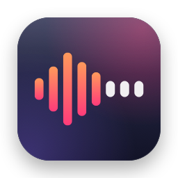
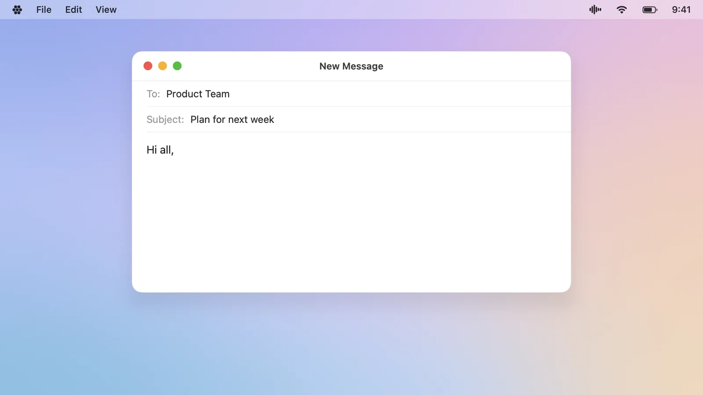
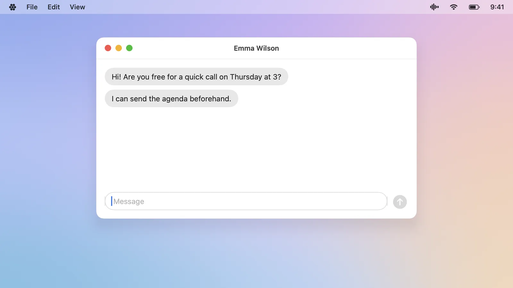
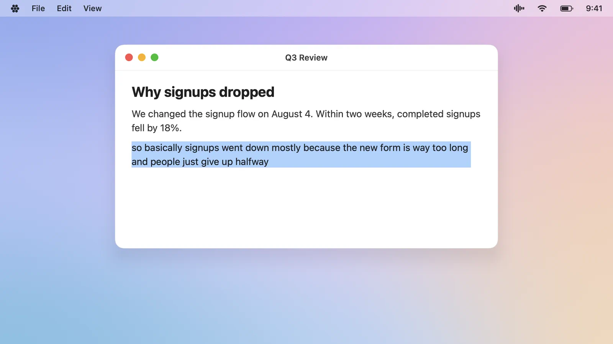
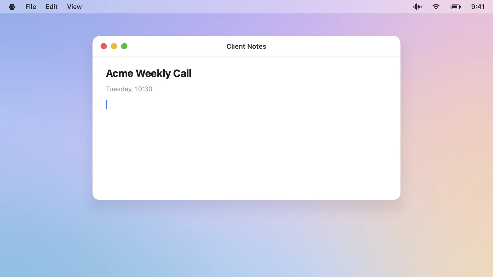
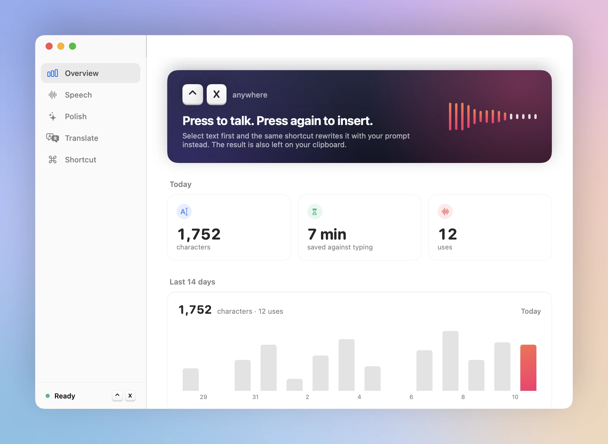
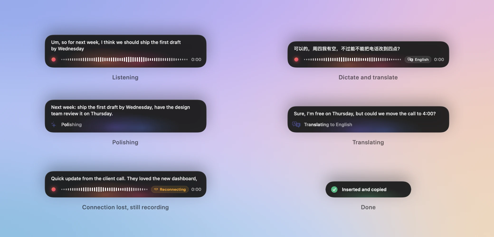
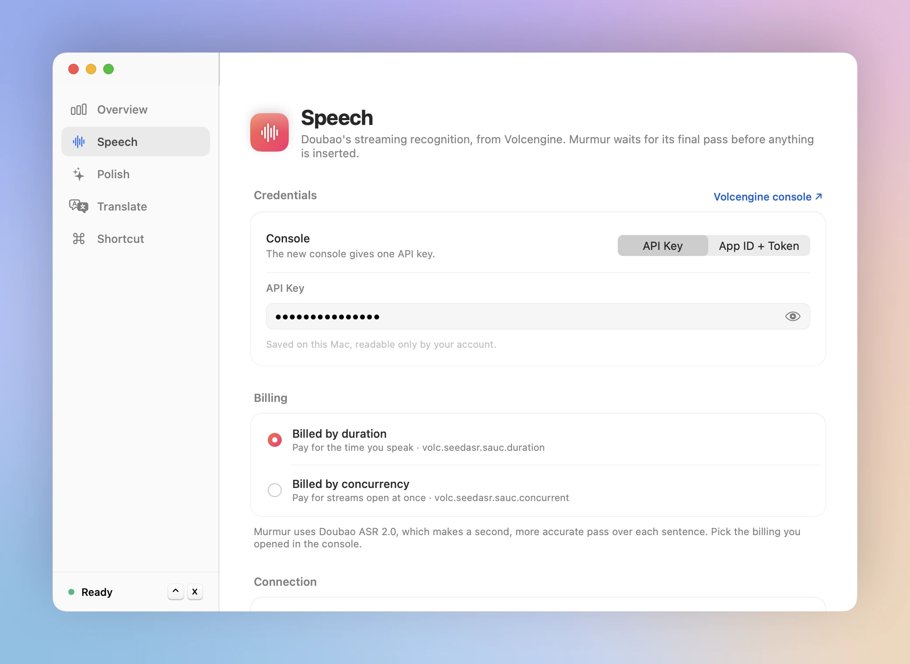

<p align="center">
  
</p>

<h1 align="center">Murmur</h1>

<p align="center">
  <b>Say it the way you think. Murmur writes it the way you'd type it.</b><br>
  Dictation for the Mac that turns what you say into clean, finished text, right where you're typing.<br>
  Polished in the language you spoke, or translated into any other.
</p>

<p align="center">
  <a href="https://github.com/MockingFinch/murmur/releases/latest"></a>
</p>

<p align="center">
  <a href="https://github.com/MockingFinch/murmur/releases/latest"></a>
  
  
</p>

<p align="center">
  
</p>

<br>

You speak several times faster than you type, but what comes out of your mouth isn't what you'd put in an email. There are *ums*, restarts, "no wait, Thursday", and sentences that wander. Murmur keeps the speed and loses the mess.

<table>
  <tr>
    <td width="33%" valign="top"><b>1 · Press <kbd>⌃</kbd> <kbd>X</kbd> and talk</b><br>In any app. Your words appear live as you speak, in a small capsule at the bottom of the screen.</td>
    <td width="33%" valign="top"><b>2 · Press <kbd>⌃</kbd> <kbd>X</kbd> again</b><br>Murmur tidies up what you said: fillers out, punctuation in, your meaning and tone kept.</td>
    <td width="33%" valign="top"><b>3 · It's written</b><br>The finished text appears at your cursor, and it's on your clipboard too.</td>
  </tr>
</table>

No window to open, no app to switch to, nothing to copy and paste. It works in Mail, Slack, WeChat, Notion, your browser, your code editor, and anywhere else you can type.

<br>

## Talk like a person. Read like a writer.

| You say | Murmur types |
|---|---|
| "Um, so for next week, uh, I think we should ship the first draft by Wednesday, then have the design team review it on Thursday, and, you know, spend Friday polishing onboarding before it goes to QA." | Next week: ship the first draft by Wednesday, have the design team review it on Thursday, and spend Friday polishing onboarding before it goes to QA. |
| "Let's meet on Tuesday, no, sorry, Wednesday at three." | Let's meet on Wednesday at 3:00. |

- **Fillers, false starts and repeats disappear.** When you correct yourself, only what you meant stays.
- **Punctuation, capitals, numbers, times and lists** come out the way you'd type them.
- **Names, product names, code, file paths and URLs are left alone,** so it's safe for technical writing and for prompting AI tools.
- **Your language stays yours.** Murmur polishes in the language you spoke, and a sentence that mixes Chinese and English keeps its mix, with the spacing right.
- **It's your prompt.** Tell Murmur how you write: your tone, your terms, your formatting habits. Try a change on a sample before you keep it.
- **It's your model.** Use any model you like, from a fast, cheap one to the best one available, or one running on your own Mac.

<br>

## Speak one language. Send another.

<p align="center">
  
</p>

| 你说 · You say | Murmur sends |
|---|---|
| 可以的，周四我有空，不过能不能把电话改到四点？我三点半之前还有一个会。 | Sure, I'm free on Thursday, but could we move the call to 4:00? I have another meeting until 3:30. |

Press <kbd>⌃</kbd> <kbd>⌘</kbd> <kbd>X</kbd> instead, and say it in the language you think in. What goes in is in the language you're writing to.

- **It reads like a native speaker wrote it,** not like a transcript run through a dictionary. Murmur cleans up what you said first, then translates the clean version.
- **English is only the default.** Pick any language your model writes: Japanese, French, German, Korean and more.
- **The capsule shows where your words are going** while you speak, so you always know which shortcut you pressed.
- **Already typed it?** Select text in any language and press <kbd>⌃</kbd> <kbd>⌘</kbd> <kbd>X</kbd> to translate it in place.

<br>

## Fix what's already written.

<p align="center">
  
</p>

Select a sentence, a paragraph or a whole draft, and press <kbd>⌃</kbd> <kbd>X</kbd>. No microphone this time: Murmur rewrites the selection with your prompt and puts the result in its place.

If you click elsewhere or change the selection while it works, Murmur won't overwrite the wrong text. The result waits on your clipboard instead.

<br>

## Never lose a word.

<p align="center">
  
</p>

The worst thing a dictation app can do is throw away two minutes of what you just said. Murmur is built so that never happens.

- **Wi-Fi drops mid-sentence? Keep talking.** The capsule says *Reconnecting*. Murmur keeps recording, reconnects on its own, catches up on what you said in the meantime and carries on, without missing a word or counting one twice.
- **Every recording is kept on your Mac until its words are in.** If the network never comes back, or your Mac restarts in the middle, choose **Transcribe Again** from the menu bar later and get the whole thing back. A dictation cut off by a crash or a quit is offered again the next time Murmur starts.
- **Your words get through even when the AI doesn't.** If polishing fails, what you said goes in as it was heard. If translating fails, the polished text goes in. You get something every time.
- **The clipboard moved on?** The menu bar keeps your last result, and the transcript exactly as it was heard, ready to copy.

<br>

## See the time you get back.

<p align="center">
  <picture>
    <source media="(prefers-color-scheme: dark)" srcset="docs/media/window-overview-dark.webp">
    
  </picture>
</p>

Murmur counts what you've written, how often you used it and how many minutes you saved against typing, today and across the last two weeks. It counts, and that's all: the text itself is never kept.

<br>

## A capsule, not a window.

<p align="center">
  
</p>

While you work, Murmur is a small capsule at the bottom of the screen. It shows your words as you say them and what's happening after you stop, then tells you when the text is in. It never takes the focus away from the app you're typing in, and <kbd>Esc</kbd> stays yours: it keeps working in your app as usual.

<br>

## Yours, end to end.

- **No account, no subscription, no Murmur server in between.** You bring your own speech key and model key and pay those providers directly, only for what you use.
- **Your voice goes only to the speech service. Your text goes only to the model you chose.** Point Murmur at a model running on your Mac, and your text never leaves it.
- **Keys stay on your Mac,** readable only by your account. Each recording is deleted as soon as its words are in.
- **Speech recognition is Doubao's,** from Volcengine, which is especially good with Mandarin, English and sentences that mix the two.

<br>

## Get started

### 1 · Install

[Download the latest Murmur](https://github.com/MockingFinch/murmur/releases/latest) (`Murmur-<version>.dmg`) and drag it to **Applications**. Murmur needs macOS 26 or later on an Apple silicon Mac.

Murmur isn't notarized by Apple, so macOS blocks the first launch. Click **Done**, open **System Settings → Privacy & Security**, and click **Open Anyway**. Or run this once in Terminal:

```bash
xattr -dr com.apple.quarantine /Applications/Murmur.app
```

Murmur lives in the menu bar. Its window opens on its own until setup is done.

### 2 · Connect speech and a model

<p align="center">
  <picture>
    <source media="(prefers-color-scheme: dark)" srcset="docs/media/window-speech-dark.webp">
    
  </picture>
</p>

- **Speech:** paste your Doubao key from the [Volcengine console](https://console.volcengine.com/speech/app). Choose *API Key* if you have the new console, or *App ID + Token* for the classic one. Pick the billing you opened, by duration or by concurrency, then click **Test Connection**.
- **Polish** (optional, but it's what makes Murmur Murmur): enter a model API's address, its key and the model's name. Anything that speaks the OpenAI API works: OpenRouter (the default), OpenAI, DeepSeek, or a model running on your Mac (no key needed). Click **Test**, then **Try it** to see your prompt work on a sample. Without a model, Murmur inserts your words as they were heard.
- **Translate** (optional): pick the language to translate into. It uses the model from Polish, so there's nothing else to set up.

### 3 · Allow the microphone and Accessibility

On the **Shortcut** page, allow the **Microphone** and **Accessibility**. Accessibility is what lets Murmur read a selection and type the result into other apps. On macOS 27, System Settings calls it **Device Control and Data Access**, under Privacy & Security.

Then press <kbd>⌃</kbd> <kbd>X</kbd> anywhere and say something.

<br>

## At a glance

| | Nothing selected | Text selected |
|---|---|---|
| <kbd>⌃</kbd> <kbd>X</kbd> | Dictate, polish, insert | Rewrite the selection with your prompt |
| <kbd>⌃</kbd> <kbd>⌘</kbd> <kbd>X</kbd> | Dictate, polish, translate, insert | Translate the selection |

- Either shortcut ends a dictation. The one you started with decides whether it's translated.
- To cancel, choose **Cancel** from the menu bar icon.
- Both shortcuts can be changed: <kbd>⌃</kbd> <kbd>X</kbd> on the Shortcut page, <kbd>⌃</kbd> <kbd>⌘</kbd> <kbd>X</kbd> on the Translate page.
- A dictation can run for up to 15 minutes. The timer turns amber in the last minute, and what you said goes in as usual.
- **Forgot it was listening?** When Doubao hears no new words for 2 minutes, Murmur stops by itself and carries on with what you said, so a shortcut pressed by accident never runs up your bill. Set your own time on the Speech page.

<br>

## Questions

<details>
<summary><b>Where exactly does the text go?</b></summary>
<br>

Into the text field where your cursor is. If there's no cursor, Murmur clicks into the text field under your mouse pointer and types there. If there's no text field at all, the text waits on your clipboard and the capsule tells you so. Every result is on the clipboard either way.
</details>

<details>
<summary><b>What does it cost?</b></summary>
<br>

Murmur is free. You pay Doubao for speech recognition and your model provider for polishing, at their own rates, only for what you use. Polishing one dictation is one short request, so a small, fast model costs very little. A model running on your Mac costs nothing. And a dictation started by accident stops by itself after 2 minutes of quiet, instead of billing you until you notice.
</details>

<details>
<summary><b>Which languages does it work in?</b></summary>
<br>

- **Writing:** any language your model writes well. Polishing keeps the language you used, and translation can take your words into French, German, Japanese, Spanish and many more. Selected text can be rewritten or translated whatever its language.
- **Speaking:** Murmur recognizes Mandarin and English, including sentences that switch between them, and several Chinese dialects, Cantonese among them. These are the languages Doubao transcribes live as you speak.
- **The app itself** is in English for now.
</details>

<details>
<summary><b>Does it work offline?</b></summary>
<br>

Recognition needs Doubao's servers, so Murmur needs a connection to turn speech into text. Losing that connection never costs you what you said, though: Murmur keeps recording, catches up when the connection returns, and keeps the recording on your Mac for **Transcribe Again** if it doesn't.
</details>

<details>
<summary><b>Pasting stopped working after an update, though Murmur is switched on.</b></summary>
<br>

macOS ties the Accessibility switch to the app's signature. Releases from 1.1.0 on share the same signature, so updates between them keep it. Coming from 1.0.0, or from a build of your own, macOS sees a different app: the old entry still shows as on, but no longer applies.

In **System Settings → Privacy & Security → Accessibility** (Device Control and Data Access on macOS 27), select Murmur and remove it with **−**. Then, on Murmur's Shortcut page, click **Open Settings** and switch the new entry on.
</details>

<details>
<summary><b>What does Murmur keep on my Mac?</b></summary>
<br>

| What | Where |
|---|---|
| API keys | `~/Library/Application Support/Murmur/credentials.json`, readable only by your account |
| Settings, translation language and prompts | macOS preferences (`local.murmur.dictation`) |
| Statistics | `~/Library/Application Support/Murmur/usage.json`: counts and timings only, never text |
| Recordings | `~/Library/Application Support/Murmur/Recordings`, readable only by your account. Each is deleted as soon as its words are in. One that couldn't be transcribed in full is kept for 7 days at most, or until you delete it from the menu bar |
| Last result and transcript | Memory only, for the menu bar's Copy items. Gone when Murmur quits |

Updates keep all of it.
</details>

<br>

---

<p align="center">
  <a href="docs/BACKGROUND.md"><b>Why Murmur exists</b></a> &nbsp;·&nbsp;
  <a href="docs/DEVELOPMENT.md"><b>Build it yourself</b></a> &nbsp;·&nbsp;
  <a href="https://github.com/MockingFinch/murmur/releases"><b>Release notes</b></a>
</p>
