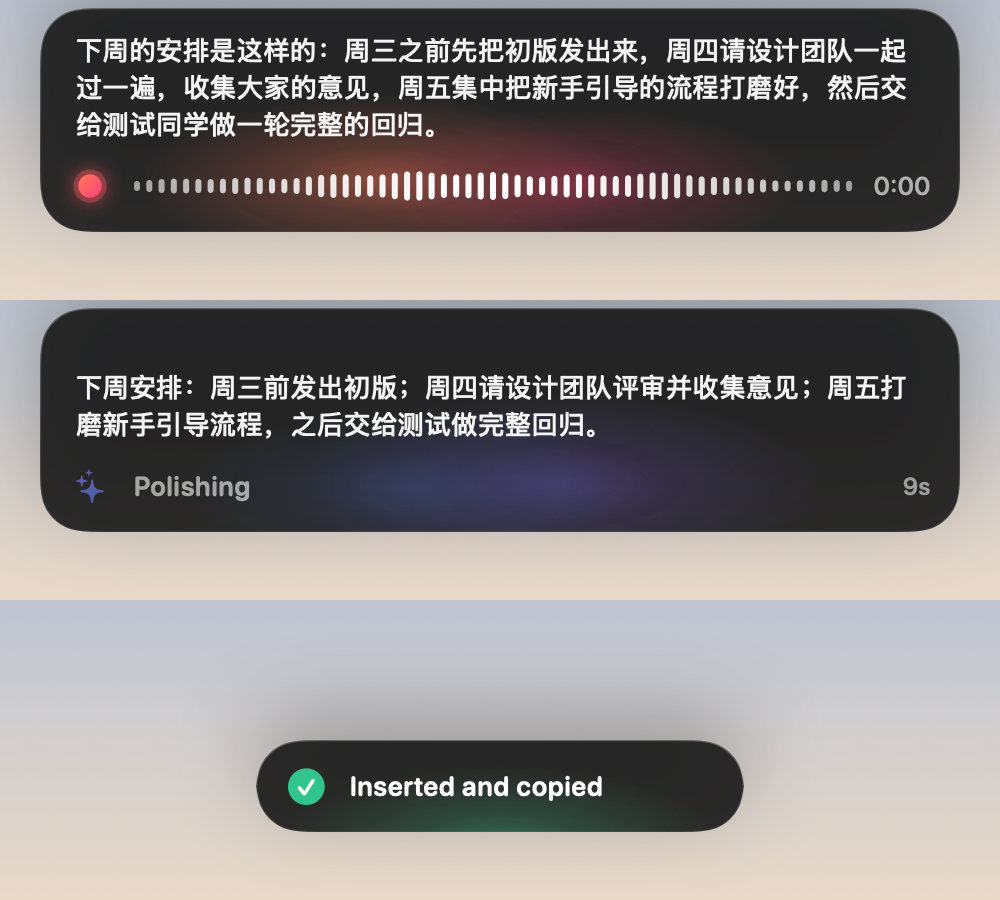
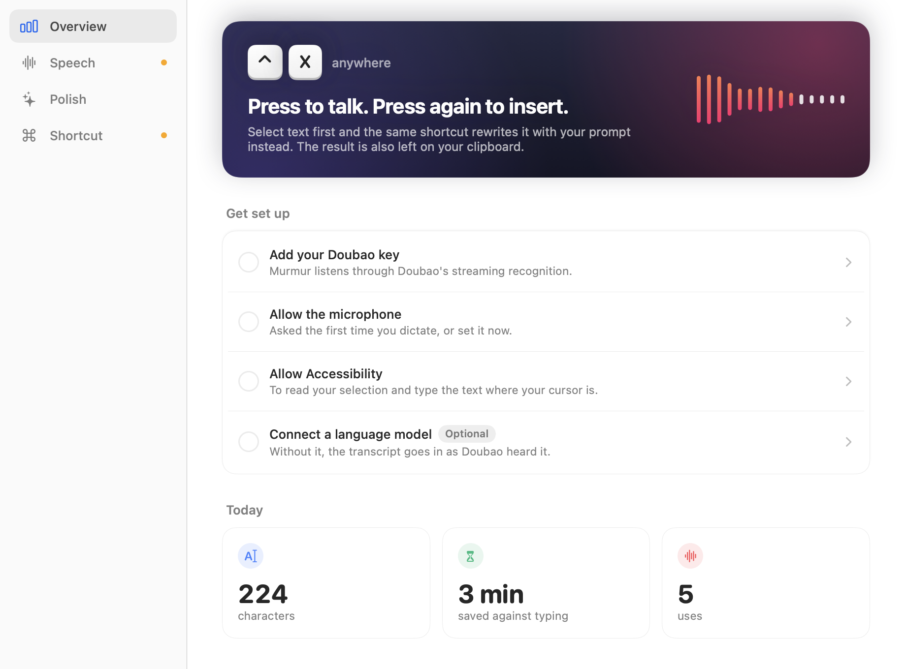

# Murmur

Dictation for macOS, and nothing else. Press **⌃X**, speak, press **⌃X** again: Doubao transcribes, a language model polishes the text with your prompt, and the result is pasted where you're typing. It's also left on your clipboard.

With text selected, the same shortcut skips the microphone and rewrites the selection with your prompt instead.

**⌃⌘X** does the same and then translates the result into your chosen language: speak Chinese, insert English (or any other pair). With text selected, it translates the selection.

<p align="center"></p>

## Install

1. Download `Murmur-<version>.dmg` from [Releases](https://github.com/MockingFinch/murmur/releases/latest) and drag **Murmur** to **Applications**. Requires macOS 26 on Apple silicon.
2. Open it. Murmur isn't notarized by Apple, so the first launch is blocked. Click **Done**, then go to **System Settings → Privacy & Security** and click **Open Anyway**. Or, in Terminal:
   ```bash
   xattr -dr com.apple.quarantine /Applications/Murmur.app
   ```
3. Murmur lives in the menu bar. Its window opens until setup is done.

## Setup

- **Speech:** paste your Doubao key from the [Volcengine console](https://console.volcengine.com/speech/app). Use *API Key* for the new console or *App ID + Token* for the classic one. Murmur uses Doubao ASR 2.0: pick the billing you opened (by duration or by concurrency), then click **Test Connection**.
- **Polish** (optional): enter a model API's endpoint, its key and the model's name. Any OpenAI-compatible API works: OpenRouter (the default), OpenAI, DeepSeek, or a model running on this Mac (no key needed). Click **Test**, then adjust the prompt if you like. **Try it** runs a real request on a sample.
- **Translate** (optional): pick the language to translate into, and adjust the translation prompt if you like. It uses the model from Polish, so there is nothing else to set up. Its shortcut, ⌃⌘X by default, is changed here too.
- **Shortcut:** allow the Microphone and Accessibility. Accessibility lets Murmur read a selection and paste the result; on macOS 27, System Settings lists it under Privacy & Security as **Device Control and Data Access**. You can change ⌃X to another shortcut here.

**Pasting stopped after an update, though Murmur is switched on?** macOS ties that switch to the app's signature. Releases from 1.1.0 on are all signed with the same certificate, so updates between them keep it. Coming from 1.0.0, or from a build of your own, macOS sees a different app: the old entry keeps showing as on but no longer applies. In Privacy & Security → Accessibility (Device Control and Data Access on macOS 27), select Murmur and remove it with **−**. Then, on Murmur's Shortcut page, click **Open Settings** and switch the new entry on.

<p align="center"></p>

## Using it

- **⌃X** starts listening. The words appear live in a capsule at the bottom of the screen.
- **⌃X** again stops. Murmur waits for Doubao's final text, polishes it, and pastes it:
  - into the field with the text cursor, if there is one;
  - otherwise into the text field under the mouse pointer, which it clicks into first;
  - otherwise nowhere: the text stays on the clipboard, and the capsule says so.
- Esc is never captured: it keeps working in the app you're using, and only ⌃X ends a dictation. To cancel, use the menu bar icon.
- **Select text, then ⌃X:** the selection is rewritten with your prompt and replaced. If the selection changed in the meantime, the result goes to the clipboard instead.
- **⌃⌘X** works the same way, with one more step: after polishing, the text is translated, and the translation goes in. While you speak, the capsule shows the language it will go in as. With text selected, ⌃⌘X translates the selection and replaces it.
- The shortcut that starts a session decides whether it translates; either shortcut ends it. If polishing fails, the transcript goes in as heard rather than waiting on a second request. If translating fails, the polished text goes in.
- Dictations stop at 15 minutes; the timer turns amber in the last minute. What you said goes in as usual.
- The menu bar menu keeps the last result and the last transcript as Doubao heard it, before polishing, in case the clipboard has moved on. If a recording couldn't be transcribed in full, it's listed there too, with **Transcribe Again**.

## Reliability

- **Nothing you say is lost to the network.**
  - If the stream to Doubao drops while you speak, the capsule shows **Reconnecting**. Keep talking. Murmur keeps every sentence Doubao has confirmed, opens a new connection and sends only the audio after them, faster than real time until it catches up. Nothing is transcribed or billed twice.
  - While you're speaking, it never gives up. Once you stop, it gives up after 5 tries in a row that get nothing back. What Doubao confirmed then goes in, along with the words still in progress, and the capsule says how much at the end is missing.
  - If Doubao refuses partway (a key or quota problem), the capsule shows **Recording only**: recording goes on, and what was confirmed until then goes in.
- **Every recording is on disk until its words are in.** It's written a moment behind the microphone, so a crash, a quit or a network that never comes back costs nothing. If the text came back incomplete, or not at all, the recording stays: choose **Transcribe Again** in the menu bar to run it through Doubao, polishing and translation again and insert the result. A recording that was cut off by a crash or a quit is offered at the next launch. Cancelling while you speak discards the recording; cancelling after you stop keeps it.
- **A lost microphone ends the dictation, not the words.** If the microphone disappears and no other takes over, what you said until then goes in.
- **Polishing has a deadline, not a hair trigger.**
  - One request carries the whole text. It gets up to 180 seconds, retries included (Polish → Timeout).
  - Keep-alives count as progress; only 20 seconds of total silence counts as a stall.
  - A failed request is sent again, up to 5 attempts in all, honoring `Retry-After`. Errors a new request can't fix (a wrong key, no credits, an unknown model) skip the wait.
  - Translating works the same way, with its own 5 attempts.
  - Your words are never dropped. If polishing still fails, the transcript goes in as Doubao heard it; if translating fails, the polished text goes in. Whatever goes in is also on the clipboard.
  - An answer cut off at the model's length limit is never inserted, since it would drop the end of what you said. The full transcript goes in instead. When OpenRouter lists how much a model can write in one answer, Murmur never asks for more.
- **Thinking is kept to a minimum.** On OpenRouter, Murmur asks each model for the least thinking it allows. Polishing gains nothing from it, and thinking by default can take a minute.
- **The connection opens while you speak**, so the answer doesn't wait on DNS and TLS after you stop.

## Privacy and storage

| What | Where |
|---|---|
| API keys | `~/Library/Application Support/Murmur/credentials.json`, readable only by your account |
| Settings | `UserDefaults` (`local.murmur.dictation`) |
| Statistics | `~/Library/Application Support/Murmur/usage.json`: counts and timings only, never text |
| Translation language and prompt | `UserDefaults`, with the other settings |
| Recordings | `~/Library/Application Support/Murmur/Recordings`, readable only by your account. Each one is deleted as soon as its text is in. One that couldn't be transcribed in full is kept for 7 days at most, or until you delete it from the menu bar |
| Last result and transcript | Memory only, for the menu bar's Copy items; gone when Murmur quits |

Audio goes only to Doubao. Text goes only to the model API you set up. Updates and rebuilds keep all of the above.

## Build from source

```bash
scripts/build.sh --open     # Swift 6 toolchain, macOS 26 SDK
```

macOS remembers Accessibility and Microphone permissions by an app's signature. Builds are ad-hoc signed by default, so each one looks like a new app: its Accessibility entry has to be removed and allowed again, as described above. To avoid that, create a local signing certificate once:

```bash
scripts/setup-signing.sh
```

It lives in its own keychain file in `~/Library/Application Support/Murmur/Signing`, separate from your login keychain and outside the repo. Every later build is signed with it, so permissions survive rebuilds. To use your own certificate instead, set `MURMUR_SIGN_IDENTITY`.

`scripts/release.sh` builds the `.dmg` and `.zip` for a release.

## Development

```bash
swift test                                     # protocol, streaming, retry and timeout tests against local fake servers
.build/debug/Murmur --snapshot /tmp/murmur     # render every capsule state and settings page to PNG
.build/debug/Murmur --check-navigation         # check that switching pages redraws the window
```

`Sources/MurmurCore` holds the Doubao binary protocol, the client for OpenAI-compatible model APIs and the statistics math, with no UI. `Sources/Murmur` is the app: `Engine/` runs a session, `System/` handles hotkeys, audio, saved keys and text insertion, and `Overlay/` and `UI/` are the interface.
