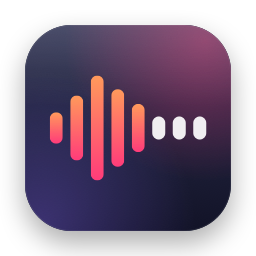
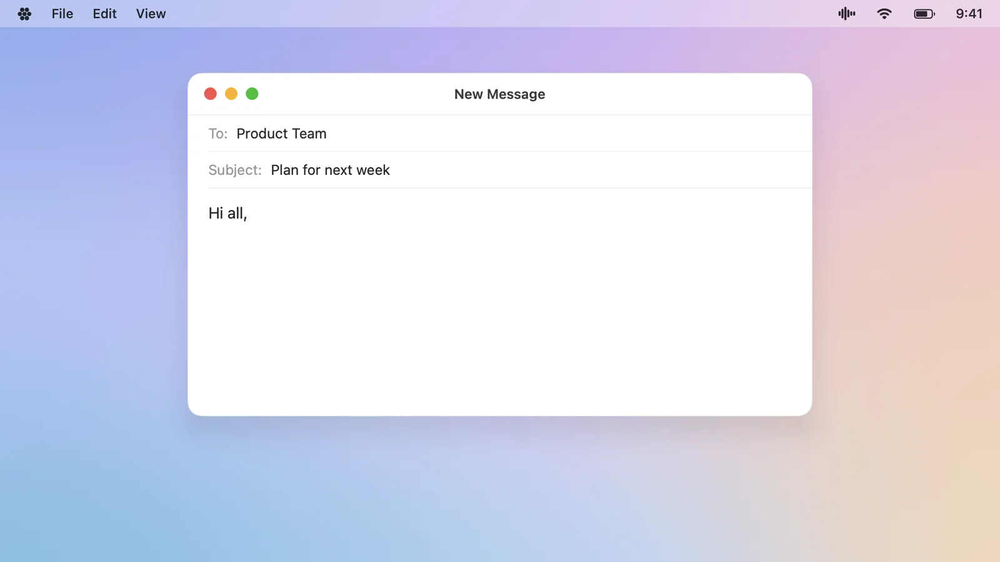
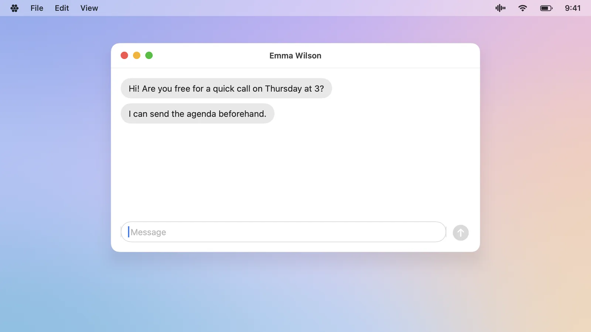
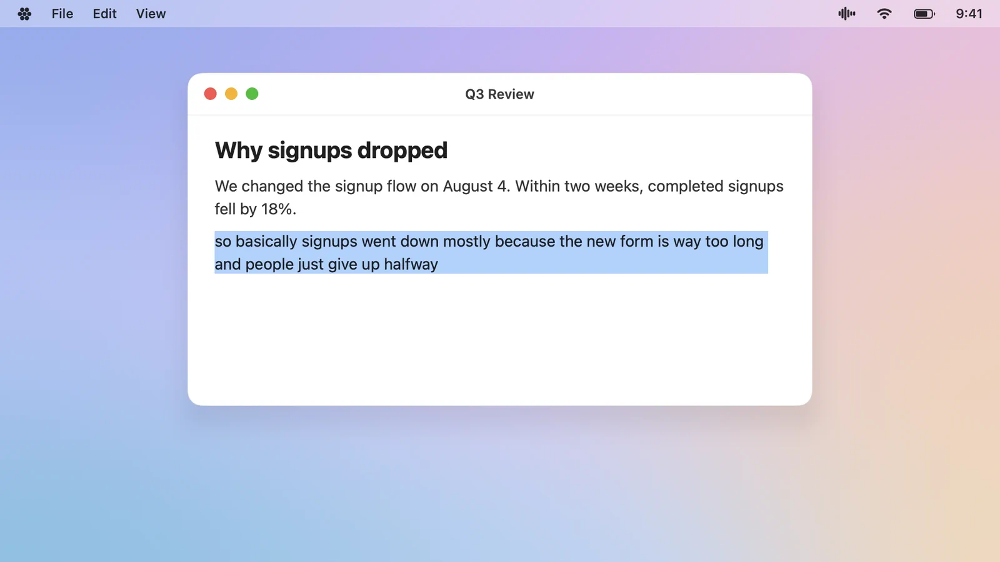
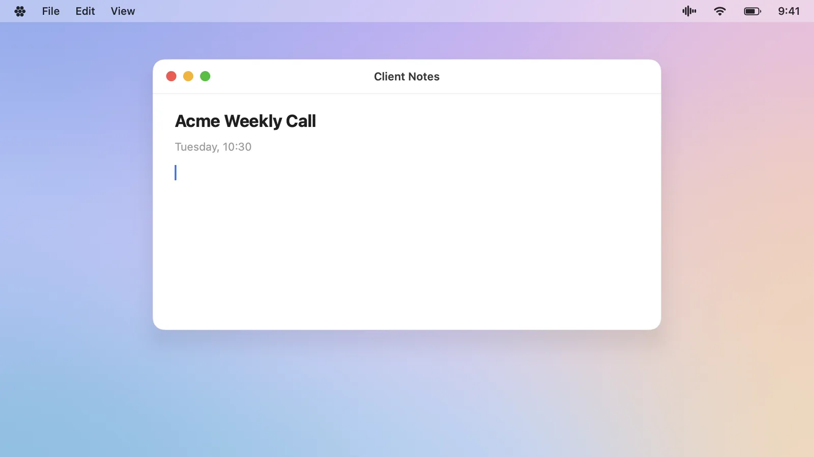
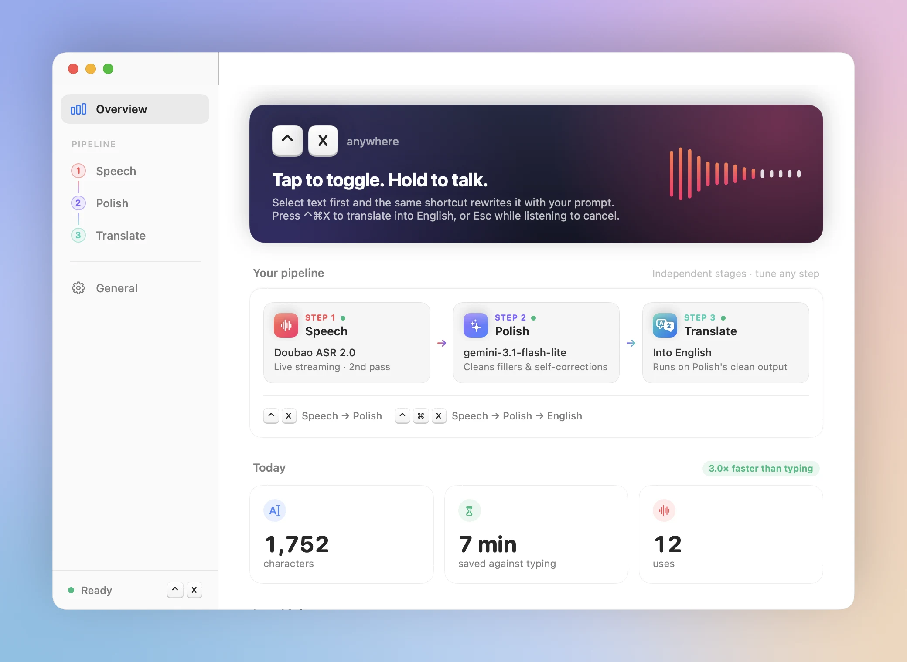
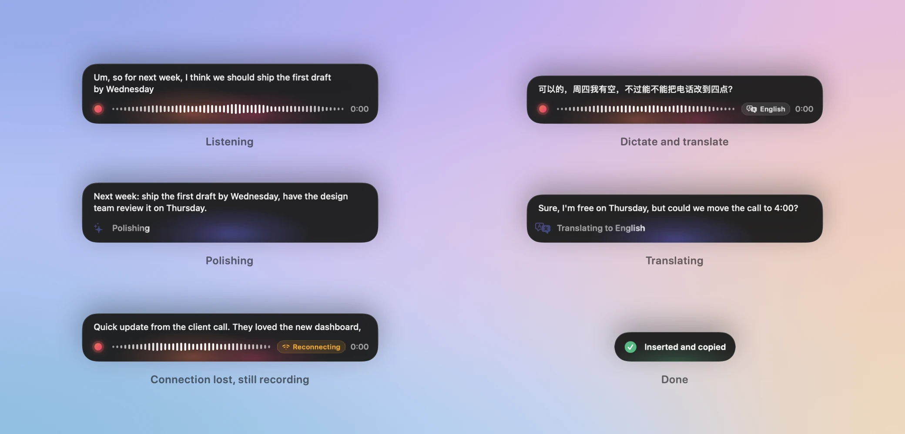
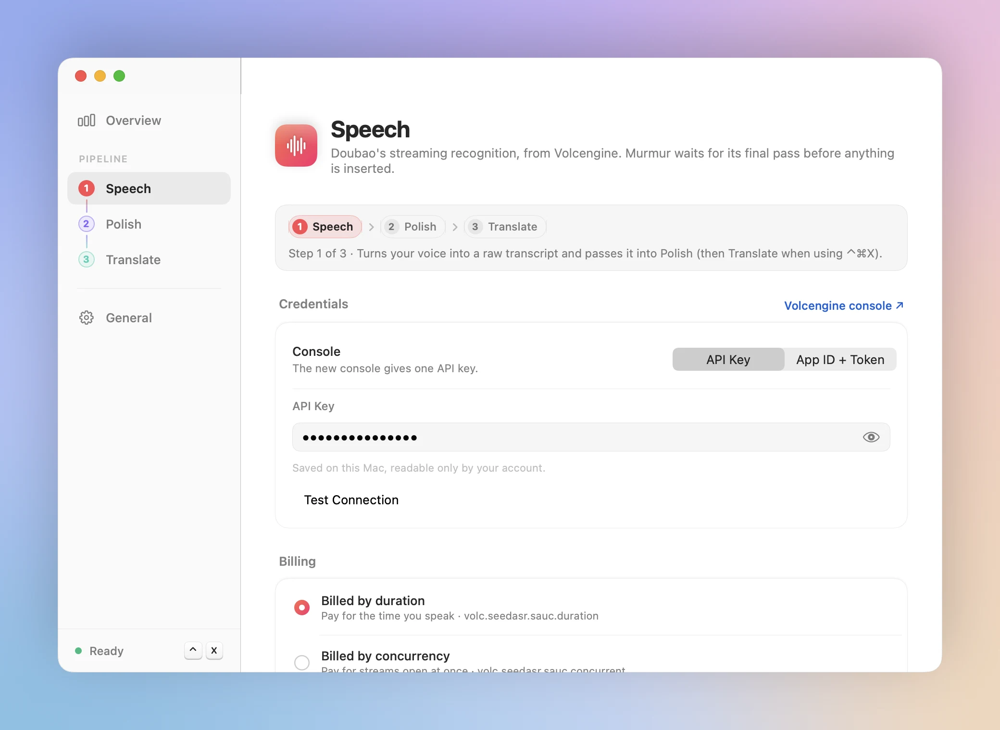

<p align="center">
  
</p>

<h1 align="center">Murmur</h1>

<p align="center">
  <b>Mac voice dictation that cleans up what you say and types it straight into any app.</b><br>
  Built for Mandarin, English, and mixed sentences, with optional live translation.<br>
  Bring your own Doubao and LLM API keys. No account, no subscription.
</p>

<p align="center">
  <a href="https://github.com/MockingFinch/murmur/releases/latest"></a>
</p>

<p align="center">
  <a href="https://github.com/MockingFinch/murmur/releases/latest"></a>
  
  
</p>

<p align="center">
  
</p>

<br>

Talking is much faster than typing, especially when you're switching between Pinyin and English or explaining context to an AI coding tool. The problem is that raw speech transcripts are messy: *ums*, restarts, and "wait, make that Thursday" don't belong in an email or Slack message.

Murmur sits in your menu bar and runs your speech through a clear, three-stage chain: **Speech (ASR) → Polish (LLM) → Translate (LLM)**. Because each stage is separate, you can tune recognition vocabulary, your writing prompt, or your translation style independently, and every improvement carries downstream.

<table>
  <tr>
    <td width="33%" valign="top"><b>1 · Speech (<kbd>⌃</kbd> <kbd>X</kbd>)</b><br>Works in Mail, Slack, WeChat, Notion, your browser, or your editor. Tap to toggle for long thoughts, or hold and release for quick replies.</td>
    <td width="33%" valign="top"><b>2 · Polish</b><br>Doubao's final transcript flows into your LLM prompt: filler words and self-corrections disappear, punctuation lands cleanly, and your tone stays intact.</td>
    <td width="33%" valign="top"><b>3 · Translate (<kbd>⌃</kbd> <kbd>⌘</kbd> <kbd>X</kbd>)</b><br>Optional third stage that translates the already-cleaned output into your target language, then pastes it in place with a quick speed payoff.</td>
  </tr>
</table>

<br>

## Cleans up how you actually talk

| What you say | What Murmur types |
|---|---|
| "Um, so for next week, uh, I think we should ship the first draft by Wednesday, then have the design team review it on Thursday, and, you know, spend Friday polishing onboarding before it goes to QA." | Next week: ship the first draft by Wednesday, have the design team review it on Thursday, and spend Friday polishing onboarding before it goes to QA. |
| "Let's meet on Tuesday, no, sorry, Wednesday at three." | Let's meet on Wednesday at 3:00. |

- Cuts out filler words, stumbles, and repeated phrases. If you backtrack mid-sentence, only your final wording stays.
- Fixes punctuation, capitalization, numbers, times, and numbered lists so you don't have to edit after pasting.
- Leaves names, product names, code snippets, file paths, and URLs untouched, so it's safe for technical notes and AI prompts. You can also add custom vocabulary in Speech so Doubao and your polish model get your jargon and names right.
- Keeps the language you spoke, including mixed Chinese and English sentences with proper spacing between scripts.
- Lets you customize the prompt, browse OpenRouter models or provider presets, and test dictation or selection rewrites on sample text right in Settings.

<br>

## Dictate in one language, paste in another

<p align="center">
  
</p>

| What you say | What Murmur pastes |
|---|---|
| 可以的，周四我有空，不过能不能把电话改到四点？我三点半之前还有一个会。 | Sure, I'm free on Thursday, but could we move the call to 4:00? I have another meeting until 3:30. |

Press <kbd>⌃</kbd> <kbd>⌘</kbd> <kbd>X</kbd> to talk in the language you think fastest in and insert text in the language your recipient reads. Murmur cleans up your spoken phrasing first, then translates the cleaned version so it reads naturally instead of like a literal transcript.

English is the default target, and you can switch languages straight from the menu bar (Japanese, French, German, Korean, or anything else your model writes). A small language badge stays visible while you record so you always know translation is active. Already typed something, or reading text on a webpage? Select it and press <kbd>⌃</kbd> <kbd>⌘</kbd> <kbd>X</kbd> to translate it in place or copy the translation to your clipboard.

<br>

## Rewrite text you've already typed

<p align="center">
  
</p>

Highlight a rough sentence, a paragraph, or a whole draft and press <kbd>⌃</kbd> <kbd>X</kbd>. Murmur skips the microphone, runs your selection through your polish prompt, and replaces it in place.

If you click away or change your selection while the model is still running, Murmur leaves your document alone and puts the rewritten text on your clipboard instead.

<br>

## Built so you don't lose a recording

<p align="center">
  
</p>

Nothing kills trust in a dictation tool faster than losing two minutes of speech to flaky Wi-Fi. Murmur handles failures so you don't have to repeat yourself:

- **Wi-Fi drops mid-sentence?** Keep talking. The bar switches to *Reconnecting*, keeps recording locally, catches up automatically once the network returns, and avoids transcribing or billing confirmed parts twice.
- **Connection stays down, or your Mac restarts?** Every recording is written to disk as you speak and only deleted after all the text comes back. Open the menu bar later and click **Transcribe Again** to recover it. Recordings cut short by a crash or quit show up automatically on next launch.
- **Model provider errors out or times out?** You still get your words. If translation fails, Murmur inserts the polished text; if polishing fails, it inserts Doubao's raw transcript.
- **Clipboard moved on?** Your last final result and your last raw transcript stay in the menu bar, ready to copy again.

<br>

## Track how much time you save

<p align="center">
  <picture>
    <source media="(prefers-color-scheme: dark)" srcset="docs/media/window-overview-dark.webp">
    
  </picture>
</p>

The Overview page tracks characters written, how many times you used Murmur, and estimated minutes saved versus typing for today and the past 14 days. Only counts and timings are saved; none of your text is ever stored.

<br>

## Stays out of your way

<p align="center">
  
</p>

While Murmur is working, it shows a small floating bar on the display with your focused window (anchored at the bottom or top, configurable in General). Multi-stage sessions display a live **Speech → Polish → Translate** stepper so you can watch each stage lock in, finish with a subtle completion chime and speed summary (characters written and time saved or speed multiplier), and fade out once the text lands. It never takes focus away from the app you're typing in. Press <kbd>Esc</kbd> while recording to cancel and discard it; once you've been talking for a while, Murmur asks for a second <kbd>Esc</kbd> so an accidental tap never wipes out a long thought. Outside of a recording, <kbd>Esc</kbd> behaves normally in your front app.

<br>

## Bring your own keys

- **Pay providers directly.** There's no Murmur account, subscription, or relay server. Just plug in your own speech and model API keys.
- **Direct connections.** Audio goes straight to Doubao (Volcengine) for Mandarin/English/mixed streaming recognition, and text goes straight to whatever model API you set. Point it at a local model on your Mac and your text never leaves your machine.
- **Local storage.** Keys stay in a user-only file on your Mac, and audio files are deleted as soon as transcription completes.

<br>

## Setup

### 1 · Install

[Download the latest release](https://github.com/MockingFinch/murmur/releases/latest) (`Murmur-<version>.dmg`) and drag Murmur into **Applications**. Requires macOS 26 or later on an Apple silicon Mac.

Because Murmur isn't notarized by Apple, macOS will block it on first open. Click **Done**, go to **System Settings → Privacy & Security**, and click **Open Anyway**. Or clear the quarantine flag once in Terminal:

```bash
xattr -dr com.apple.quarantine /Applications/Murmur.app
```

Murmur runs from the menu bar and opens its Settings window automatically until setup is finished.

### 2 · Connect Doubao and a model

<p align="center">
  <picture>
    <source media="(prefers-color-scheme: dark)" srcset="docs/media/window-speech-dark.webp">
    
  </picture>
</p>

- **Speech (required):** Paste your Doubao key from the [Volcengine console](https://console.volcengine.com/speech/app). Use *API Key* for the new console, or *App ID + Token* for the classic one. Select the billing mode you enabled (duration or concurrency), click **Test Connection**, and optionally pin a preferred microphone (handy to stop macOS from switching AirPods into call mode) or add custom vocabulary terms.
- **Polish (optional, recommended):** Pick a provider preset (OpenRouter, OpenAI, DeepSeek, Ollama, or LM Studio) or enter any OpenAI-compatible base URL, API key, and model ID. On OpenRouter you can browse cached models and pricing directly. Click **Test**, then use **Try it** to preview your prompt on sample dictation or selection text. Without a model, Murmur inserts Doubao's raw transcript.
- **Translate (optional):** Pick a target language on the **Translate** page or straight from the menu bar. It uses the same model configured under Polish.

### 3 · Allow Microphone and Accessibility

On the **Overview** checklist or the **General** page, grant **Microphone** and **Accessibility** access so Murmur can hear you, read highlighted text, and paste into other apps. (On macOS 27, Accessibility is listed as **Device Control and Data Access** under Privacy & Security.)

After that, press <kbd>⌃</kbd> <kbd>X</kbd> anywhere and start talking.

<br>

## Shortcuts and limits

| Shortcut | Nothing selected | Text selected |
|---|---|---|
| <kbd>⌃</kbd> <kbd>X</kbd> | Dictate, polish, and paste | Rewrite the selection with your prompt |
| <kbd>⌃</kbd> <kbd>⌘</kbd> <kbd>X</kbd> | Dictate, polish, translate, and paste | Translate the selection |

- Tap to toggle for longer recordings, or hold the shortcut while speaking and release to stop immediately. Press the same shortcut again to finish, or press the other shortcut mid-dictation (or while polishing) to switch between Polish and Translate without losing what you've said.
- Press <kbd>Esc</kbd> while recording to cancel and discard it (long recordings ask for a second <kbd>Esc</kbd> to prevent accidental loss). Once you've stopped talking, choose **Cancel** from the menu bar instead.
- Both shortcuts can be remapped: <kbd>⌃</kbd> <kbd>X</kbd> on the **General** page, and <kbd>⌃</kbd> <kbd>⌘</kbd> <kbd>X</kbd> on the **Translate** page.
- Single recordings run up to 15 minutes (the timer turns amber in the final minute, then finishes and pastes as usual).
- **Left the mic on by accident?** After 2 minutes with no new words from Doubao, Murmur shows a brief countdown and stops listening automatically so it doesn't keep running up your API bill. You can adjust this timeout (or set it to Never) on the **Speech** page.

<br>

## FAQ

<details>
<summary><b>Where does the text get pasted?</b></summary>
<br>

Into whatever text field has your cursor. If no field is focused during dictation, Murmur clicks into a text field under your mouse pointer in the active app and pastes there. If there's no editable field, it leaves the result on your clipboard and tells you in the floating bar. By default, finished text stays on your clipboard as a backup; if you prefer keeping your previous clipboard intact, enable **Restore clipboard after pasting** in **General**.
</details>

<details>
<summary><b>How much does it cost to run?</b></summary>
<br>

Murmur itself is free. You only pay Doubao for speech recognition and your LLM provider for polishing or translation at their standard pay-as-you-go rates. Because each dictation is a single short request, a fast, inexpensive model costs fractions of a cent per use, and a local model on your Mac costs nothing. The 2-minute quiet auto-stop also protects you from accidentally leaving a stream open.
</details>

<details>
<summary><b>Which languages are supported?</b></summary>
<br>

- **Speaking:** Mandarin, English, mixed Chinese/English sentences, and several Chinese dialects including Cantonese (whatever Doubao's live streaming recognizer supports).
- **Writing and translating:** Any language your LLM handles well. Polishing keeps your original language, and you can translate dictated or selected text into English, Japanese, French, German, Spanish, and more.
- **App interface:** English for now.
</details>

<details>
<summary><b>Does it work offline?</b></summary>
<br>

Speech recognition runs on Doubao's servers, so you need an internet connection to turn audio into text. If your connection drops while you're talking, Murmur keeps recording locally, reconnects when it can, and saves the audio for **Transcribe Again** in the menu bar if you stay offline.
</details>

<details>
<summary><b>Pasting stopped working after an update, even though Accessibility is switched on.</b></summary>
<br>

macOS binds Accessibility permissions to an app's code signature. Official releases from 1.1.0 onward share the same certificate, so updating between them preserves permissions. If you're upgrading from 1.0.0 or switching to your own local build, macOS treats it as a different app even though the old toggle still looks enabled.

Open **System Settings → Privacy & Security → Accessibility** (or **Device Control and Data Access** on macOS 27), select Murmur, and remove it with **−**. Then click **Open Settings** on Murmur's General page and enable the new entry.
</details>

<details>
<summary><b>What does Murmur store on my Mac?</b></summary>
<br>

| Data | Location |
|---|---|
| API keys | `~/Library/Application Support/Murmur/credentials.json` (user-readable only) |
| Settings, target language, and prompts | macOS preferences (`local.murmur.dictation`) |
| Usage stats | `~/Library/Application Support/Murmur/usage.json` (counts and timings only, no text) |
| Saved recordings | `~/Library/Application Support/Murmur/Recordings` (user-readable only). Deleted once transcription completes; incomplete recordings are kept up to 7 days or until you delete them from the menu bar |
| Last result and raw transcript | In memory only, for the menu bar's Copy actions. Cleared on quit |

Updating the app preserves all of these.
</details>

<br>

---

<p align="center">
  <a href="docs/BACKGROUND.md"><b>Why Murmur exists</b></a> &nbsp;·&nbsp;
  <a href="docs/DEVELOPMENT.md"><b>Build it yourself</b></a> &nbsp;·&nbsp;
  <a href="https://github.com/MockingFinch/murmur/releases"><b>Release notes</b></a>
</p>
